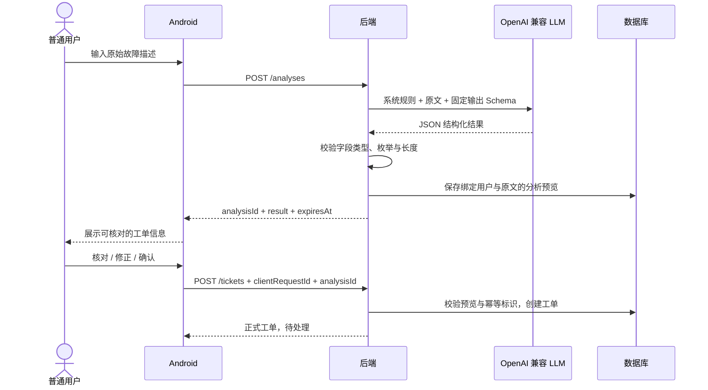
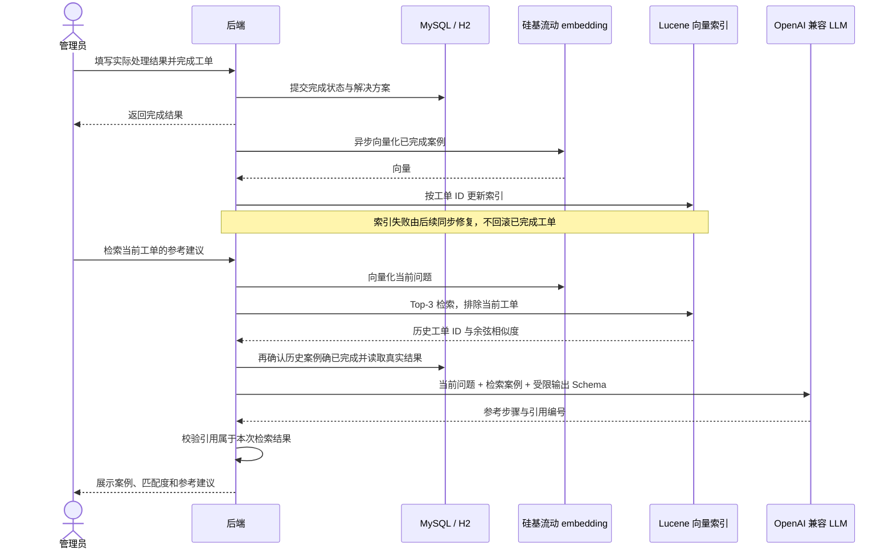

# 开发流程与报告素材

## 交付方法

按 SPEC 的基础业务 → LLM 受理 → RAG 辅助 → 增强输入顺序推进。每个阶段先明确数据、权限和状态约束，再实现后端与 Android，最后执行接口测试与设备验收。

本轮先完成并验证基础闭环，再接入智能分析和检索。开发记录保留真实过程；本文件提炼可用于报告的设计过程，不代替最终项目报告。

## 阶段一：从需求到基础业务

1. 从 SPEC 提取两个角色和状态流转，确定普通用户与管理员可执行的操作。
2. 建立用户表和工单表，将原始描述、结构化信息、处理结果分开存储。
3. 明确注册登录、本人 / 全部工单、详情、接单、完成和统计接口。
4. 后端实现输入校验、密码哈希、JWT 验证和事务；状态不能由客户端任意指定。
5. Android 建立 Activity / Fragment → ViewModel → Repository → Retrofit 的调用关系。
6. 用后端集成测试验证业务和权限，再通过模拟器执行真实用户与管理员的切换流程。

## 阶段二：智能受理

分析预览不是正式工单，有效期 30 分钟。模型输出不控制业务权限或工单状态。描述变化后应重新分析或明确作为手动提交；原文不会被模型摘要替换。暂不启用智能服务时仍可手动填写，界面清楚标识来源。

2026-10-22 的交互修订来自实际使用反馈：旧表单要求手动用户同时填写原始描述和摘要，造成重复录入。改为两个互斥入口，手动提交直接创建结构化工单；智能提交先生成预览再确认。新增影响范围、故障开始时间、错误提示、已尝试操作，均可选，并同步修改实体、V3 迁移、请求 / 响应 DTO、Gemini Schema、Android 草稿与详情、RAG 文本和接口契约。AI 的价值是从自然描述整理多个有用字段，避免通过新增无意义必填项制造使用障碍。用户未提供的原文不生成替代文本；保留原文的要求适用于实际存在的输入。

## 阶段三：知识辅助

数据库是事实来源，Lucene 是可重建的嵌入式向量检索存储。索引通过模型空间、维度与内容指纹区分，重复同步更新同一文档；更换 embedding 模型后使用独立索引目录，避免混用不同语义空间。

每分钟扫描一批已完成工单进行补偿，同步接口也可安排一批处理。无相似案例时明确返回空结果；模型建议失败时保留已找到的案例。建议不会自动写入 resolution 或修改工单状态。

## 关键技术取舍

2026-10-22 的协议修订将服务商与业务分开：统一使用 OpenAI 兼容 Chat Completions，通过 LLM_BASE_URL / LLM_API_KEY / LLM_MODEL 配置服务商与模型，Embedding 仍单独配置。使用 json_object / json_schema / text 三种输出约束级别，但后端业务校验始终执行。协议通用并不意味着所有中转站支持相同参数或模型，实际账号与网络仍需联调。新智能来源改为 LLM，历史 GEMINI 原样保留；报告应区分早期原生协议实现与当前兼容协议版本。

| 决策 | 原因与代价 |
| --- | --- |
| Java / XML / MVVM | 符合课程 SPEC，将展示与请求状态分开；需要维护 Java 与 XML 两套文件 |
| Spring Boot 单体 | 接口、认证、事务和 AI 集中管理，便于课程部署；当前未针对多实例扩展设计 |
| JPA + Flyway | 减少基础 CRUD，同时保留可追踪的数据库迁移；复杂查询需关注执行次数 |
| JWT + 数据库角色 | 移动端携带令牌，权限仍由数据库中的实际角色决定；暂不提供主动吊销 |
| H2 dev / MySQL 部署 | 本地无需先配账号即可运行；两种数据库仍须分别验证，不能仅凭 H2 测试声称 MySQL 可用 |
| Lucene HNSW 向量索引 | 不额外部署向量服务，文件可持久化；单实例文件锁，默认最多 1024 维，大规模或多实例时需替换存储实现 |
| 异步索引 + 批量补偿 | 外部 embedding 失败不影响实际工单完成；检索可能短暂滞后，并非立即一致 |
| 服务端模型调用 | 密钥不下发客户端，统一校验输出；真实可用性仍依赖供应商账号、网络与模型权限 |

## 可用于报告的素材索引

- 需求来源和阶段计划：`docs/需求与实施计划.md`。
- 系统图、ER 图、状态机与参考关系：`docs/架构设计.md`。
- REST 契约与错误状态：`docs/API接口.md`。
- 操作过程与变更记录：`docs/开发记录.md`。
- 自动化测试与真实联调范围：`docs/测试与验收.md`。
- 界面截图：`docs/screenshots/`；验收账号与工单属于测试数据，不代表真实用户数据。

## 后续报告章节建议

需求分析 → 总体架构 → 数据库设计 → Android 分层与界面 → 后端业务与权限 → LLM 结构化受理 → RAG 知识辅助 → 测试与结果 → 部署与局限 → 总结。

报告应注明真实模型联调状态；本地供应商测试接口只能证明请求、解析和业务处理逻辑，不能用来证明 Gemini 分类准确率或 BAAI 的实际检索质量。
