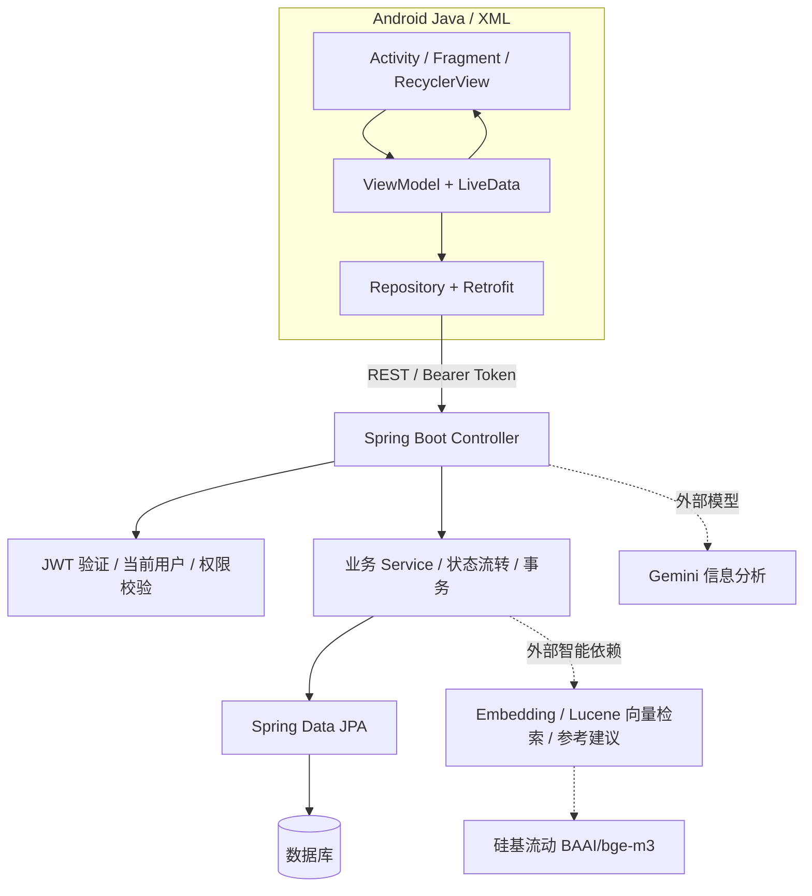
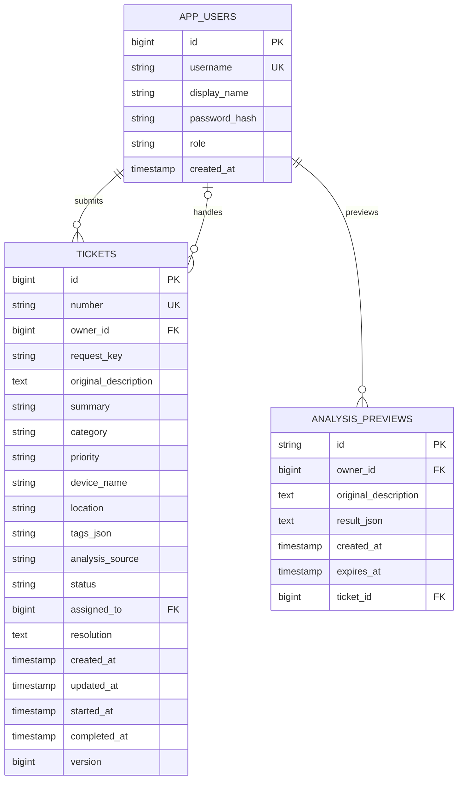
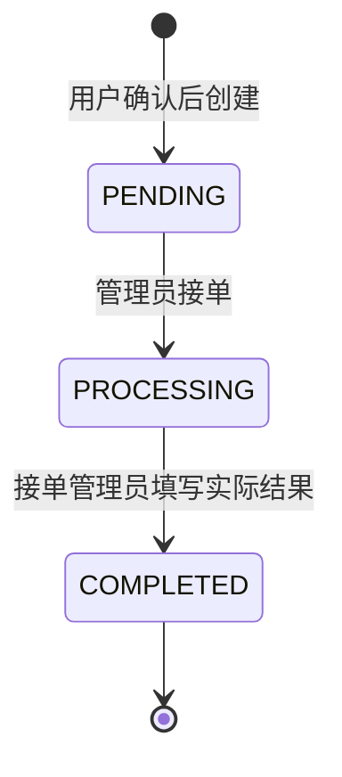

# 架构设计与技术决策

## 项目定位

本项目基于 SPEC v1.1 独立实现面向报修场景的 Android 智能工单系统。用户确认工单信息，管理员负责实际处理；模型承担信息整理与知识辅助。使用两种角色、简单状态机和单体后端，控制课程项目的实现规模。

2026-10-20 用户确认：后端从零开发；无现有项目数据库和服务器配置；后续可使用自有 VPS；LLM 采用 Gemini；embedding 采用硅基流动的 BAAI 免费模型；ORM 和向量库自主选择；中文界面注重排版，不使用 emoji 装饰。

## 系统边界



实线表示基础业务路径；虚线表示依赖外部智能服务的路径。智能模块代码与本地测试已实现，真实 Gemini / 硅基流动账号尚未配置，不能据此认为外部服务已联通。

## Android 分层

| 层 | 文件 / 目录 | 职责 |
| --- | --- | --- |
| 容器与导航 | `MainActivity` | 登录状态切换、底部导航、工单创建与详情返回栈 |
| 界面 | `ui/` + XML Layout | 输入、展示、确认对话框和交互，不直接操作数据库 |
| 状态 | `viewmodel/WorkorderViewModel` | 持有页面状态与表单草稿，调用 Repository，通过 LiveData 发布结果 |
| 数据入口 | `data/WorkorderRepository` | 创建 Retrofit、发起请求、转换接口错误 |
| API 声明 | `data/ApiService` | 描述 REST 路径、请求体和响应模型 |
| 模型 | `data/Models` | 与后端 DTO 对应的 Java 数据模型 |
| 本地会话 | `data/SessionStore` | Android Keystore AES-GCM 加密保存 JWT；账号资料保存在应用私有配置中 |

请求状态区分空闲、加载、成功与失败。界面只在自己的 View 生命周期内观察数据。退出账号后清空业务状态，通过请求序号丢弃旧账号或旧筛选条件的迟到响应。表单草稿由 ViewModel 保存，可跨屏幕旋转保留；进程被系统终止后的草稿恢复留待后续完善。

首版使用简洁浅色主题，深绿色强调操作，卡片显示状态、类别和时间；普通用户首页强调报修与进度，管理员首页强调待办与分类统计。导航与页面文案使用中文，不使用 emoji 作为装饰。

## 后端分层

```text
backend/src/main/java/com/smartworkorder/
├── WorkorderApplication.java
├── auth/       账号实体、注册登录、当前用户身份
├── config/     Spring Security、JWT 编解码、管理员初始化
├── ticket/     工单实体、DTO、Repository、Service、Controller
├── ai/         Gemini 调用、结构化校验、分析预览
├── rag/        Embedding、Lucene 索引、历史案例与建议
└── common/     业务异常及统一接口错误
```

- Controller 接收输入并执行 Jakarta Validation；Service 控制业务规则和事务；Repository 负责持久化查询。
- HTTP 请求与响应使用独立 DTO，不直接返回 JPA 实体，也不接受客户端传入角色、所有者、工单状态或处理人。
- 采用 Spring Data JPA，减少重复 CRUD 代码。建表使用 Flyway 版本化迁移，Hibernate 仅验证结构，不在生产中自动修改表结构。
- 后端使用 Java 17、Spring Boot 3.5.16；Android 业务保持 Java 8 兼容语法。两端 Java 版本用途不同。

## 身份与权限

- 注册接口只能创建 USER；ADMIN 通过启动配置首次初始化。
- 密码使用 BCrypt 哈希，不存明文；响应不包含密码哈希。
- JWT 使用 HS256 签名、固定 issuer 与过期时间（12 小时），后续请求从 Bearer Header 读取。
- 角色从数据库读取，客户端选择首页不构成授权依据。
- 普通用户列表与统计始终限定本人；访问他人工单详情返回 404，避免暴露记录存在性。
- 管理员可以查看全部工单；处理中的工单由接单管理员填写完成结果。
- Android 禁止备份会话，Release 禁止明文 HTTP；Debug 为本地联调允许 HTTP。
- 退出登录清除本地凭据，当前 JWT 不提供服务端主动吊销；如以后需要强制下线，应增加令牌版本或吊销机制。

## 数据模型



原始描述按用户输入保存；展示摘要单独存储。类别、优先级使用 SPEC 的中文业务值；状态使用固定英文编码，界面统一映射中文。时间以 UTC 持久化并以 ISO 8601 返回，由客户端按本地时区展示。

`owner_id + request_key` 唯一约束用于防重复提交。同一用户创建时短暂锁定其账号记录，再检查请求标识；状态更新时锁定工单记录，避免两个管理员同时接单。`version` 进一步提供乐观锁保护。

## 状态流转



不能从待处理直接完成、重复接单或重复完成。后端返回 409 说明记录状态已变化；普通用户不能调用处理接口。关闭、撤销、删除、转派不属于当前基础实现。

## 本地运行与 VPS 迁移

本机 MySQL 服务检查时为停止状态。为了无需用户先提供数据库账号即可验证基础流程，提供 `dev` profile，使用 H2 文件数据库。这是独立的本地开发模式，不能称为 MySQL 已接通。

`mysql` profile 读取数据库地址、用户名、密码、JWT 密钥及首次管理员密码等环境变量。本轮已使用独立临时数据目录、13306 端口和随机数据库密码验证 MySQL 8.0.45，未修改本机 MySQL 服务。后续部署到 VPS 时使用 MySQL、HTTPS 反向代理和持久化备份，并关闭 dev profile；尚未登录 VPS 或创建云资源。

## 智能模块实现

- Gemini：后端通过原生 `generateContent` REST 接口传入系统规则和 responseSchema，校验固定字段；用户核对后创建工单；服务不可用时保留原文并明确报错，不将关键词规则冒充 LLM。
- 分析预览：绑定用户、完整原文、模型结果和过期时间，有效期 30 分钟；确认时校验归属、原文一致性和是否已使用。用户可修正结构化信息，也可明确改为手动填写。
- Embedding：适配硅基流动 `BAAI/bge-m3`，默认 1024 维，模型名和 API 地址可配置。供应商当前价格页列有免费项，实际可用范围以账号权限和服务条款为准。
- RAG：已完成工单与解决方案 → embedding → 向量存储 → Top-K 相关案例 → Gemini 参考建议；展示来源和匹配度，始终由管理员实际处理并填写最终结果。
- 向量存储：采用 Lucene 9.12.3 HNSW 文件索引作为嵌入式向量检索存储，没有单独部署 Qdrant、Milvus 等向量数据库服务。按 embedding 地址、模型与维度的哈希分目录，存储工单 ID 和内容指纹；按 ID 更新，不重复增加文档。
- 完成事务提交后异步索引；每分钟分批扫描历史记录补偿，管理员也可请求同步。索引失败不影响真实工单完成。
- 查询返回 Top-3，排除当前工单，默认余弦相似度阈值 0.35；再从业务数据库确认案例已完成。无匹配不生成建议；建议失败时仍可展示案例；引用编号必须来自检索结果。
- 当前限制：单后端实例维护索引，向量维度不超过 1024；内容截断用于控制输入量；历史数据量大或需要多实例时应替换向量存储实现。真实模型服务与检索质量尚待联调。

Lucene 的字段与查询用法核对自 [KnnFloatVectorField](https://lucene.apache.org/core/9_12_3/core/org/apache/lucene/document/KnnFloatVectorField.html) 和 [KnnFloatVectorQuery](https://lucene.apache.org/core/9_12_3/core/org/apache/lucene/search/KnnFloatVectorQuery.html)。

## 参考来源与独立实现边界

已阅读用户提供的 REFERENCES.md，并查看以下仓库的 README 与目录。没有克隆或复制完整项目及模块。

| 来源 | 借鉴的设计思路 | 本项目的取舍 |
| --- | --- | --- |
| [Ticketing-System](https://github.com/shreyasnandurkar/Ticketing-System) | REST 分层、JWT、查询和状态流转 | 独立实现两个角色、三步流转；不引入评论或邮件 |
| [it-support-ticket-system](https://github.com/alfahami/it-support-ticket-system) | RBAC、状态修改 DTO 与错误边界 | 采用当前身份限定查询范围，记录关键处理时间 |
| [RAG-Based-Support-Ticket-System](https://github.com/YatinAdityaT/RAG-Based-Support-Ticket-System) | 历史案例、向量化与检索分离 | 留待 RAG 阶段参考流程，模型使用用户指定服务 |
| [DEPI RAG 工单项目](https://github.com/nour-hatem/RAG-Based-Intelligent-Support-Ticket-System-DEPI-Project) | 分类、检索与人工确认组合 | AI 不改变最终处理状态 |

技术核对来源：[Spring Boot 3.5 环境要求](https://docs.spring.io/spring-boot/3.5/system-requirements.html)、[Android Lifecycle](https://developer.android.com/jetpack/androidx/releases/lifecycle)、[RecyclerView](https://developer.android.com/jetpack/androidx/releases/recyclerview)、[Gemini 结构化输出](https://ai.google.dev/gemini-api/docs/structured-output)、[硅基流动 embedding 接口](https://siliconflow.readme.io/reference/createembedding)、[硅基流动价格页](https://siliconflow.cn/pricing)。

## 报告写作记录原则

本文件回答“如何设计、为什么这样选”；[开发记录](开发记录.md)回答“每轮实际做了什么”；接口文档回答“如何联调”；测试与验收文档回答“如何证明功能可用”。最终项目报告应基于实际交付版本整合这些材料，保留真实测试结果，不把计划写成已实现。
