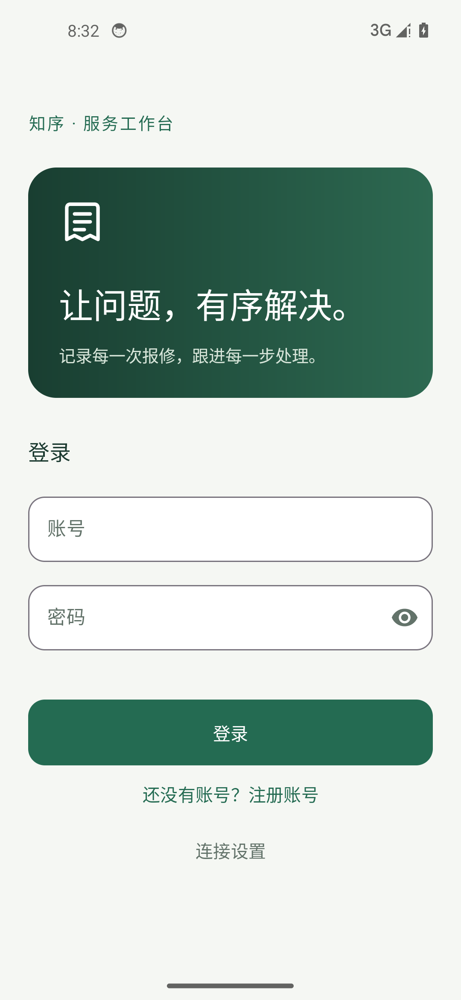
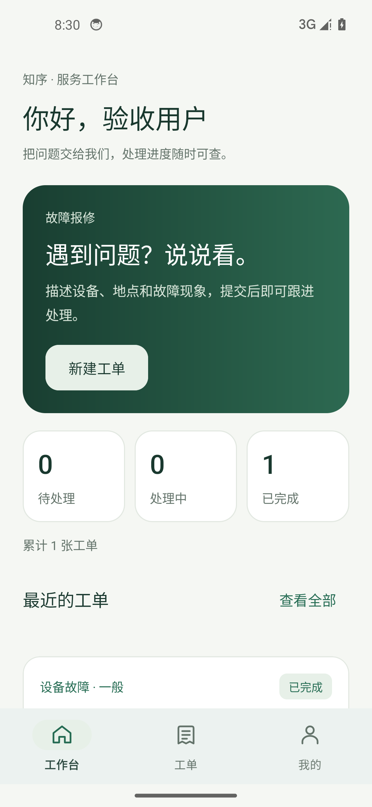
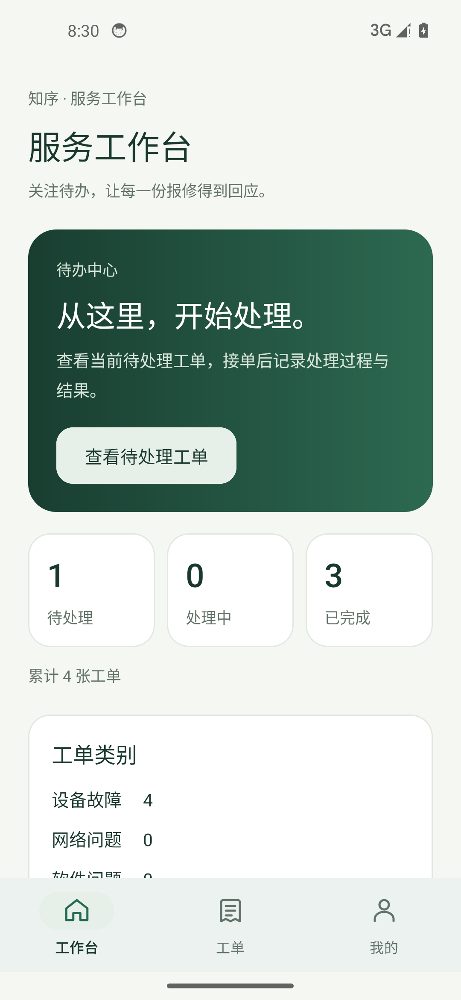
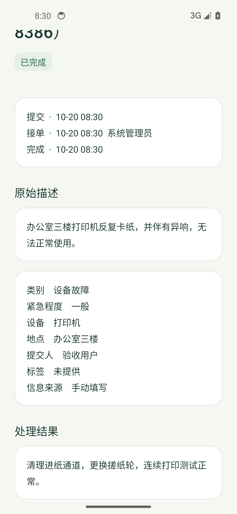

# 测试与验收记录

初次验证日期：2026-10-20；2026-10-22 补充双录入流程、排查线索和 OpenAI 兼容协议验证。各节按实际版本保留历史结果，当前协议与测试范围见后文“OpenAI 兼容协议切换”。本文件明确区分实现检查、自动化测试、设备运行和外部服务联通。

## 后端自动化验证

`mvn package` 中执行 9 项测试，全部通过，0 失败、0 错误、0 跳过。

| 测试类 | 数量 | 覆盖范围 |
| --- | --- | --- |
| WorkorderFlowTest | 6 | 完整状态流转、结果和原文、用户隔离、角色权限、枚举与非法字段、幂等与分页、登录认证、并发重复提交和同时接单 |
| IntelligenceFlowTest | 3 | 分析预览与确认、非法 / 截断模型输出、限流、向量维度与零向量、真实 Lucene 检索、案例引用、生成失败降级与不自动完成工单 |

智能测试使用本地 JDK HTTP 服务器模拟供应商响应，后端仍经过实际 HTTP 序列化、H2 事务和真实 Lucene 文件索引。它证明代码路径与业务边界，不证明真实 Gemini 的分类质量、BAAI 的检索质量或外部账号权限。

## Android 构建与设备验证

- Debug APK 已构建。
- `lintDebug` 已通过，0 errors；仍有若干警告，主要包括初始 target API 34、未使用资源和部分中文文案直接写在 Java 中。后续可统一文案资源；目前不以屏蔽 Lint 错误方式通过检查。
- Android 14 / API 34 的 Pixel 5 模拟器执行 `connectedDebugAndroidTest`，2 项测试通过，其中 1 项为模板环境检查、1 项为完整业务流程。
- 完整流程覆盖：普通用户注册 → 填写文字工单 → 核对提交 → 管理员登录 → 搜索该工单 → 接单 → 填写实际处理结果 → 完成 → 普通用户重新登录 → 查看状态和结果。
- 同一流程分别连接 H2 开发后端及 MySQL 后端通过。

测试会创建独立验收账号和工单，应连接开发 / 测试数据库。界面截图使用实际执行流程中的验收数据。

## MySQL 实际验证

为避免依赖或修改系统 MySQL 服务，本轮建立独立的临时 MySQL 8.0.45 进程：仅监听 127.0.0.1:13306，数据和日志位于被忽略的 `.validation/`，数据库应用账号使用随机密码。

验证内容：

1. `mysql` profile 通过环境变量启动，不加载 dev 数据库配置。
2. Flyway 成功执行 V1、V2 两个迁移，JPA schema validation 通过。
3. Android 模拟器连接基于 MySQL 的后端，完成用户与管理员全流程。
4. `scripts/Verify-Api.ps1` 通过实际 HTTP 完成注册、登录、重复提交、接单、完成、原文保留、结果查询和本人统计。

未修改或启动系统的 MySQL80 服务，未连接 VPS。临时进程在验收后停止；开发者后续运行可直接使用默认 H2 文件模式，或自行配置 MySQL。

临时 MySQL 数据目录的清理命令被自动审批策略拦截（工具仅返回 `blocked by policy`），因此保留 `.validation/mysql-data/`，约 200 MB，已由 `.gitignore` 排除。数据库进程已正常关闭，未继续尝试删除。默认 H2 文件模式也已实际启动，健康接口返回 UP。

## 本轮发现与修复

- Android 点分式样式名隐式寻找父样式：补充明确的空 parent，解决资源链接错误。
- API 27 的导航栏属性位于 API 24 通用主题：移除该属性，保留最低版本兼容性。
- 流程测试将滚动区域中的按钮视为未显示：改为等待有效可见状态，再滚动执行。
- Windows 中运行 JAR 占用打包目标：停止本轮临时后端后重新打包，通过验证。
- 为密码增加 UTF-8 72 字节限制，避免超长多字节密码触发 BCrypt 异常。
- 为幂等重试补充完整结构化字段比较，并增加并发创建与接单测试。
- 增加模型 JSON 字段类型校验，避免数字被宽松转换成文本后误接受。
- 新增“改为手动填写”入口，便于分析过期或用户主动选择手动确认。

## 尚未验证或交付

| 项目 | 当前状态 |
| --- | --- |
| 实际 LLM / 中转站账号、具体模型、网络联通 | 待配置和联调 |
| 硅基流动真实 embedding 调用 | 待配置和联调 |
| 真实案例的分类 / 检索准确率 | 待建立评测样本，当前不声称准确率 |
| AI 分析及 RAG 的真实服务设备端验收 | 智能录入已通过本地供应商模拟接口的设备测试；真实服务和 RAG 设备流程待验证 |
| API 24 / Android 7 真机兼容性 | 已做静态兼容检查，尚未设备运行 |
| Release 签名、HTTPS 域名、VPS 部署 | 尚未实施 |
| 语音、图片、图表、关闭工单 | P2 后续增强 |
| OCR、多模态、Rerank | P3 可选 |

## 2026-10-22：双录入流程与排查线索

本节保留双录入功能完成时、仍使用 Gemini 原生协议的验收结果；协议切换后的结果见后文，前文保留 10 月 20 日的历史验收范围。

| 验证 | 结果与范围 |
| --- | --- |
| 后端打包与集成测试 | 13 项全部通过，0 失败、0 错误、0 跳过；WorkorderFlowTest 8 项、IntelligenceFlowTest 4 项、MigrationCompatibilityTest 1 项 |
| Android 构建 | Debug APK 与 androidTest APK 构建通过 |
| Android Lint | 通过，0 errors、21 warnings；未屏蔽错误 |
| 独立模拟器测试 | Android 14 / API 34 上 4 项全部通过，0 失败、0 跳过；后端使用 8082 端口与独立 H2 内存库 |
| 本地 Gemini 测试接口 | UI 测试通过本地 HTTP 响应验证回填，不访问真实 Gemini；可复用脚本另通过有 / 无排查线索两种响应检查 |

新增及调整的测试覆盖：

- 手动工单无需原始描述，新增四个字段持久化后可在详情读取；空值、缺省值、超长输入、必填摘要与重复提交内容校验。
- 旧 H2 数据库由 V2 升级 V3 后保留已有原文（含首尾空格），旧工单新增字段为空，新工单可以没有独立原文。
- 智能分析提取排查线索，原文未提及的选填信息为空；用户修正结构化字段后确认，仍保留完整原文与 GEMINI 来源。
- CreateTicketValidationTest：智能 / 手动切换、旋转后保留表单、摘要错误定位与纠正、手动提交不夹带智能原文草稿。
- SmartEntryTest：描述必填提示、智能回填、修改原文使旧预览失效、重新分析、人工修正、旋转恢复、取消确认后继续编辑、提交后核对原文与来源。
- WorkorderJourneyTest：以无独立原文的手动工单完成注册、创建、四个新字段的详情展示、管理员接单 / 完成、用户查看结果。

测试在独立的 emulator-5556 与 8082 后端执行，没有在用户使用的 emulator-5554 上安装、清空数据或提交工单，没有停止用户当时的 8080 后端。后端在 `.validation/entry-backend/` 的源码副本中构建，避免占用用户正在运行的编译目录。测试输出位于被 Git 忽略的 `.validation/` 和本地构建报告目录。本次只验证了 H2 的 V3 迁移；前文 MySQL 的实际验收对应 V1 / V2，不能作为 V3 已在 MySQL 上运行的证据。

### 复现智能录入设备测试

以下按当前 OpenAI 兼容版本复现：使用 Python 3 运行 `python scripts/Start-LlmFixture.py`。该脚本仅监听本机 8083，是固定场景的测试接口，不是智能处理实现。给独立测试后端设置以下 Spring 参数：

| 参数 | 测试值 |
| --- | --- |
| server.port | 8082 |
| spring.datasource.url | jdbc:h2:mem:ui_validation;MODE=MySQL;DATABASE_TO_LOWER=TRUE |
| app.ai.llm-base-url | http://127.0.0.1:8083/v1 |
| app.ai.llm-model | vendor/fixture:free |
| app.ai.llm-key | local-fixture-only（测试占位值） |
| app.ai.llm-response-format | json_object |
| app.ai.embedding-key | 空值，不调用外部 embedding |
| app.rag.auto-sync-enabled | false |

构建并将两个 APK 安装到独立测试模拟器后，运行以下命令，将 `TEST_SERIAL` 替换为该模拟器编号。测试会清空该模拟器中 App 的测试会话并创建验收账号，不应选择正在使用的个人设备：

```powershell
adb -s TEST_SERIAL shell am instrument -w -r -e apiBaseUrl http://10.0.2.2:8082/api/ -e smartFixture true com.example.smart_workorder_system.test/androidx.test.runner.AndroidJUnitRunner
```

`SmartEntryTest` 只有显式传入 `smartFixture=true` 才运行，否则跳过，避免将真实模型的非确定输出与测试接口的固定内容混淆。四项设备测试传入该参数运行；真实 LLM / 中转站与硅基流动账号、网络及效果仍待配置和联调。

## 2026-10-22：OpenAI 兼容协议切换

后端在独立的 `.validation/openai-backend/` 源码副本中打包，20 项测试全部通过，0 失败、0 错误、0 跳过：

| 测试类 | 数量 | 当前覆盖 |
| --- | --- | --- |
| LlmClientTest | 7 | 实际 HTTP 鉴权与消息体、斜杠 / 冒号模型名、基础 / 完整端点、json_object / json_schema / text、严格 JSON、截断 / 拒绝 / 空值 / 工具调用、服务错误与不回显上游敏感信息 |
| IntelligenceFlowTest | 4 | OpenAI 兼容分析与确认、严格字段校验、历史 GEMINI 来源重试兼容、无原文手动工单的 RAG 生成、真实案例引用与非法建议降级、向量边界 |
| WorkorderFlowTest | 8 | 基础业务、权限、幂等、四个线索字段、手动无独立原文；测试显式禁用真实智能密钥，不受开发者本机配置影响 |
| MigrationCompatibilityTest | 1 | 原有 V2 → V3 升级与数据保留；本次协议调整不增加迁移 |

Android Debug / 测试 APK 构建与 Lint 均通过，0 errors、21 warnings。使用本地 OpenAI 兼容固定响应接口，不调用真实收费服务、不使用本地真实密钥。JSON 模式和协议约束依据官方文档，第三方服务的支持范围仍待账号联调确认。

独立 emulator-5556 对接 8082 测试后端与 8083 OpenAI 兼容模拟接口，4 项设备测试全部通过，0 失败、0 跳过。覆盖智能回填、原文变化后重新分析、人工修正后创建与 LLM 来源展示，及手动创建到管理员完成的闭环。未在用户 emulator-5554 上安装 / 清空 App；测试结束后停止本轮模拟器、后端及接口进程。本次未重跑 MySQL 验收，也没有调用实际服务商。

## 截图








